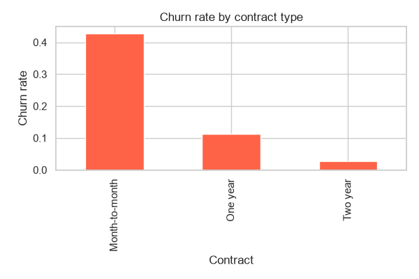
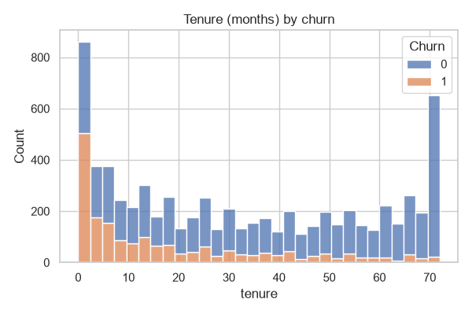
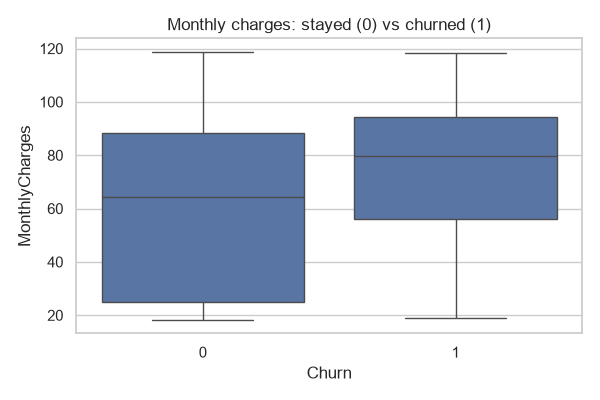
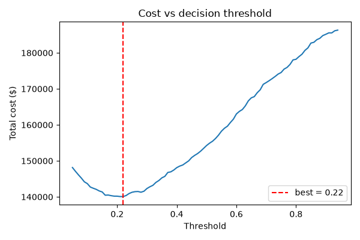
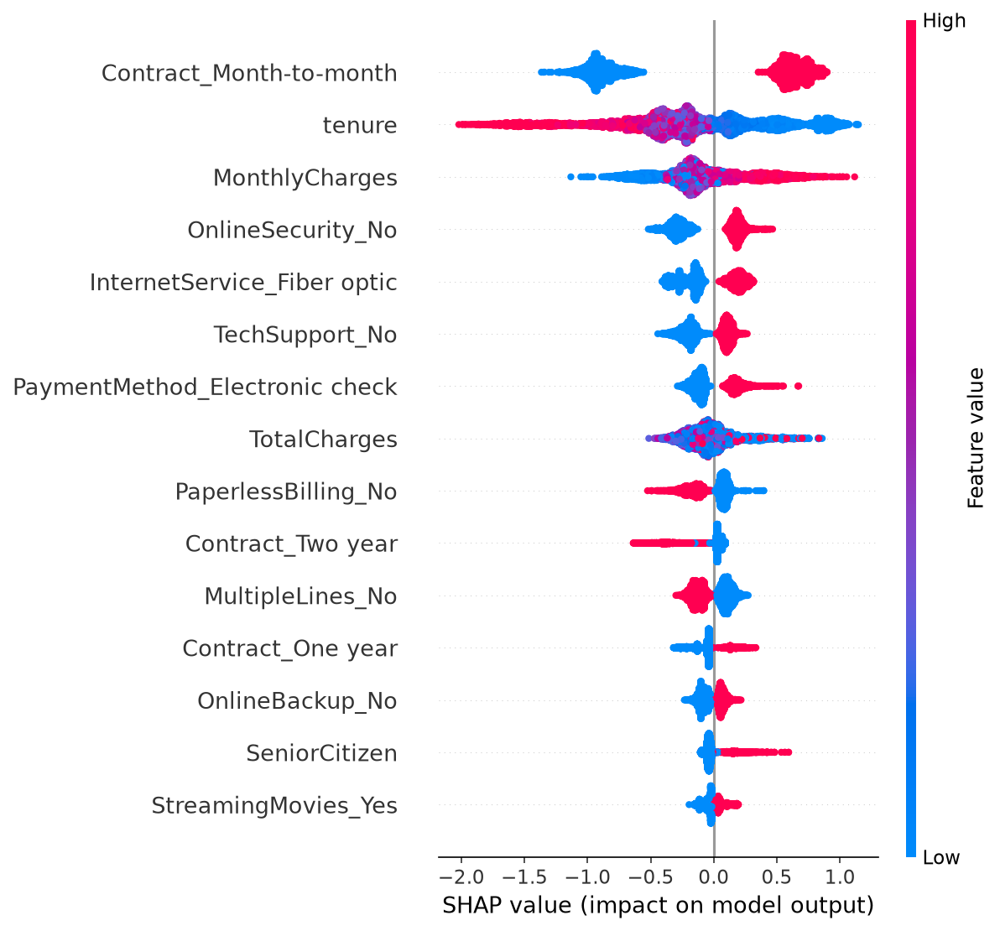
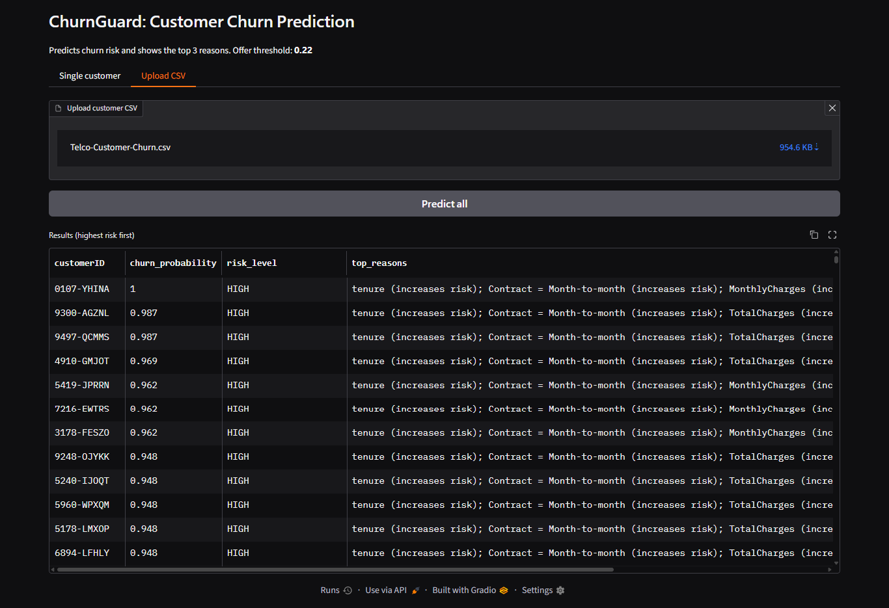

# ChurnGuard: Customer Churn Prediction & Retention Tool

**Live demo:** https://churnguard-9ae79yrg92vtepagyymdoe.streamlit.app/
**Demo video:** <PASTE YOUR LOOM / YOUTUBE LINK HERE>

ChurnGuard predicts which telecom customers are likely to leave, explains why, and estimates how much revenue a retention campaign can save. Every prediction in the app shows its top 3 reasons.

## Problem
Subscription companies lose revenue when customers leave silently. The retention team has a limited budget, so it needs to know who to contact, and why that customer is at risk.

## Dataset
Telco Customer Churn (IBM sample data, Kaggle): 7,043 customers, 21 columns. About 26.5% of customers churned, so the data is imbalanced. The only missing values were 11 blank `TotalCharges` entries (brand-new customers), which were set to 0.

## Approach
1. **EDA** (`day1_eda.py`): churn rate by contract type, tenure, monthly charges and internet service. Charts are saved in `reports/`.
2. **Model comparison** (`day2_models.py`): baseline, Logistic Regression, Random Forest and XGBoost, compared with 5-fold stratified cross-validation.
3. **Imbalance handling** (`day3_imbalance.py`): class weights vs SMOTE vs nothing. SMOTE is inside an `imblearn` Pipeline, so it is applied only to training folds (no leakage).
4. **Calibration** (`day3_calibration.py`): isotonic calibration of the XGBoost probabilities.
5. **Threshold from business cost** (`day4_threshold.py`): decision threshold chosen using a cost matrix.
6. **Explainability** (`day4_shap.py`): SHAP summary plot and per-customer explanations.
7. **Apps**: `app.py` (Gradio) and `streamlit_app.py` (Streamlit). Both take a single customer or a CSV upload and return churn probability, risk level and the top 3 reasons.
8. **Business report** (`day5_report.py`): expected savings from targeting at-risk customers.

## What drives churn (EDA)
| Contract type | Tenure | Monthly charges |
|---|---|---|
|  |  |  |

- Customers on a month-to-month contract churn far more often than customers on one-year or two-year contracts.
- Most churners are new customers with a short tenure.
- Churners tend to pay higher monthly charges.
- Fiber optic customers churn more than DSL customers.

The model agrees with this: the top SHAP drivers are tenure, contract type and monthly/total charges.

## Why not accuracy?
About 73.5% of customers stay, so a model that predicts "nobody leaves" would already be 73.5% accurate and completely useless. The main metric is **PR-AUC (average precision)**, which measures how well the model finds the minority class (churners). A dummy model scores 0.265 on it (equal to the churn rate), so anything above that is real signal. Precision and recall are reported alongside it.

## Results (5-fold stratified CV)

| Model | PR-AUC | ROC-AUC | Precision | Recall | F1 |
|---|---|---|---|---|---|
| XGBoost | 0.661 | 0.843 | 0.524 | 0.776 | 0.626 |
| Logistic Regression | 0.655 | 0.845 | 0.513 | 0.802 | 0.626 |
| Random Forest | 0.603 | 0.824 | 0.557 | 0.641 | 0.596 |
| Baseline (dummy) | 0.265 | 0.500 | 0.000 | 0.000 | 0.000 |

### Class weights vs SMOTE
| Setup | PR-AUC | Precision | Recall | F1 |
|---|---|---|---|---|
| XGB, class weights | 0.661 | 0.527 | 0.789 | 0.632 |
| XGB, nothing | 0.660 | 0.652 | 0.524 | 0.581 |
| LogReg, nothing | 0.657 | 0.658 | 0.553 | 0.601 |
| LogReg, SMOTE | 0.656 | 0.519 | 0.797 | 0.628 |
| LogReg, class weights | 0.655 | 0.513 | 0.802 | 0.626 |
| XGB, SMOTE | 0.654 | 0.594 | 0.652 | 0.622 |

All setups land within 0.007 PR-AUC of each other, so the choice of imbalance technique makes almost no difference on this dataset. What changes the outcome is the decision threshold, which is why it is chosen from business cost.

### Calibration
Brier score went from 0.1356 to 0.1353 after isotonic calibration, a tiny change. XGBoost's probabilities were already close to reliable. The calibrated model is still the one used in the apps.

## Decision threshold (cost-based)
Assumptions (these are my own assumptions, not measured values):
- A retention offer costs **$10** per customer.
- Losing a customer costs **$100**.
- An offer saves **50%** of the churners who receive it.

In theory a customer should get an offer when `probability > offer cost / (save rate x lost cost) = 10 / (0.5 x 100) = 0.20`. Searching thresholds on out-of-fold predictions gave **0.22**, which matches.



| | Value |
|---|---|
| Threshold | 0.22 |
| Customers flagged | 3,198 |
| Churners caught | 1,576 |
| Churners missed | 293 |
| Wasted offers | 1,622 |
| Cost with no action | $186,900 |
| Cost with ChurnGuard | $140,080 |
| **Expected savings** | **$46,820 (25.1%)** |

### If the budget is limited (target only the top-risk customers)
| Target | Customers | Churners reached | Net gain |
|---|---|---|---|
| Top 10% | 704 | 535 | $19,710 |
| Top 20% | 1,408 | 945 | $33,170 |
| Top 30% | 2,112 | 1,240 | $40,880 |

The savings depend directly on the assumed offer cost, loss cost and save rate. Change them in `day4_threshold.py` to match a real company.

## Explainability


The plot shows the global drivers. For individual customers the apps show the top 3 SHAP reasons, for example:
- A new month-to-month customer paying $90 a month: **85.5% churn probability, HIGH risk**. Reasons: short tenure, month-to-month contract, total charges.
- A two-year customer with 60 months of tenure: **7.6% churn probability, LOW risk**.

## App screenshots

**Streamlit (live demo)**

| High-risk customer | Low-risk customer |
|---|---|
|  |  |


**Gradio (local version)**



## Project structure
```
app.py                  Gradio app (run locally)
streamlit_app.py        Streamlit app (live demo)
day1_eda.py             Cleaning + EDA charts
day2_models.py          Model comparison (stratified CV)
day3_imbalance.py       Class weights vs SMOTE
day3_calibration.py     Calibration + final model
day4_threshold.py       Cost-based threshold
day4_shap.py            SHAP explanations
day5_report.py          Business report
data/                   Raw and cleaned dataset
reports/                Charts and result tables
screenshots/            App screenshots
churn_model.joblib, explainer_bundle.joblib, threshold.json   Saved artifacts
```

## How to run
```
pip install -r requirements.txt
pip install gradio==6.29.1        # only needed for app.py

python day1_eda.py
python day2_models.py
python day3_imbalance.py
python day3_calibration.py
python day4_threshold.py
python day4_shap.py
python day5_report.py

python app.py                     # Gradio, opens at http://127.0.0.1:7860
streamlit run streamlit_app.py    # Streamlit, opens at http://localhost:8501
```
Place the Kaggle CSV in `data/` before running `day1_eda.py`. The saved model files are already in the repo, so you can run either app directly without retraining.

## Deployment note
The live demo is the Streamlit version, hosted on Streamlit Community Cloud. Hugging Face Spaces now requires a paid plan for Gradio apps, so the Gradio version is provided for local use.

## Limitations
- Only one dataset snapshot is used, with no time dimension, so we cannot test how the model holds up as customer behaviour changes.
- Business costs and the 50% save rate are assumptions. Real savings depend on the real offer and how customers respond.
- The demo CSV (`telco_clean.csv`) is the same data the model was trained on, so probabilities on it look more confident than they would on new customers. Use the cross-validation metrics above for real performance.
- SHAP shows what drives the model, not what causes churn.
- The model does not estimate customer lifetime value or recommend which offer suits which customer (possible future work).

## Tech stack
Python, pandas, scikit-learn, XGBoost, imbalanced-learn, SHAP, Gradio, Streamlit
